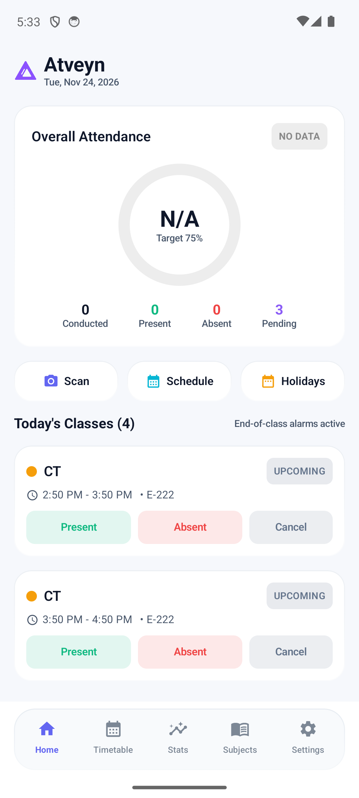
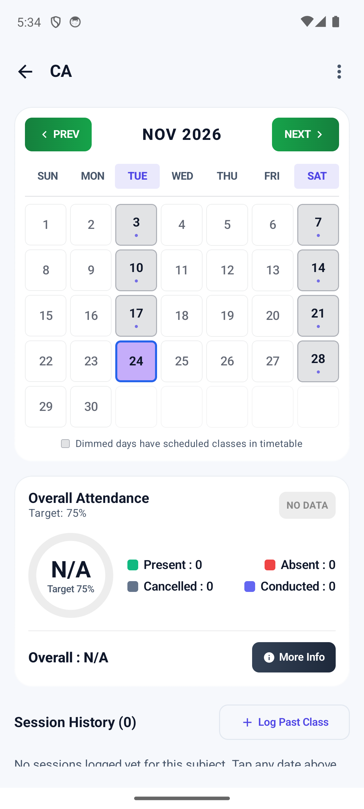
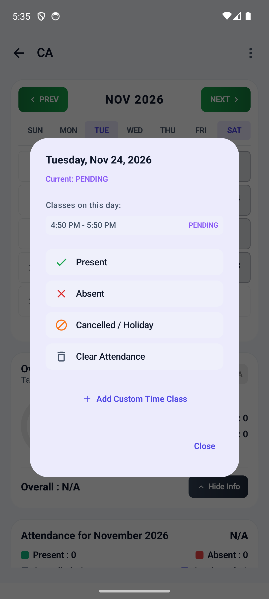
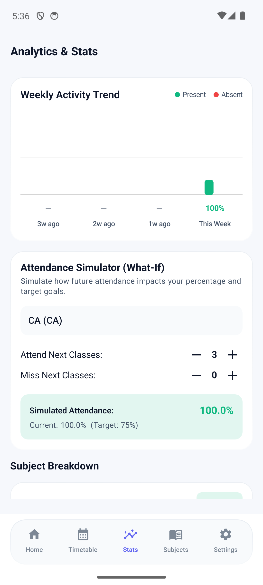
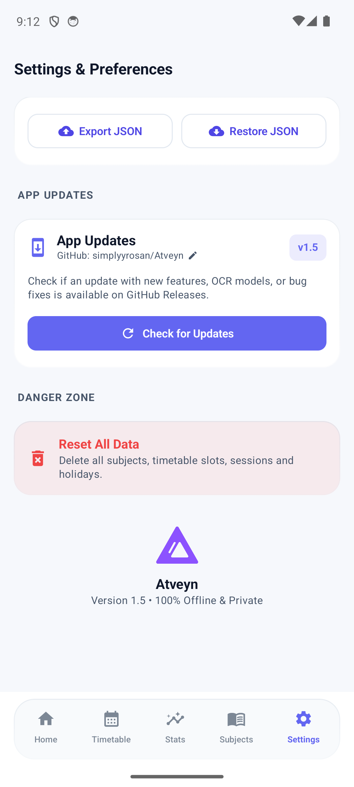

<p align="center">
  
</p>

<h1 align="center">Atveyn</h1>

<p align="center">
  <strong>Smart, Offline-First Attendance Tracking & Timetable Management for Students</strong>
</p>

<p align="center">
  <a href="https://github.com/simplyyrosan/Atveyn/releases/latest">
    
  </a>
  
  
  
  
</p>

---

## 📱 App Screenshots

<p align="center">
  
  &nbsp;&nbsp;
  
  &nbsp;&nbsp;
  
  &nbsp;&nbsp;
  
  &nbsp;&nbsp;
  
</p>

<p align="center">
  <em>Home Dashboard &bull; Timetable-Dimmed Calendar &bull; Quick Attendance Marking &bull; What-If Simulator &bull; In-App GitHub Updates</em>
</p>

---

## ⚡ Key Features

### 📸 On-Device Timetable OCR Scanner
- Scan complex college and university timetables straight from your camera, gallery image, or PDF document.
- Powered completely on-device by **Google ML Kit Text Recognition** — zero network requests, zero server dependencies.
- **Critical Noon Recognition**: Accurately distinguishes `11:00 AM – 12:00 NOON` from `12:00 NOON – 01:00 PM` without misinterpreting noon as midnight.
- **Merged Period Detection**: Detects multi-hour laboratory blocks (e.g. 2-hour or 3-hour lab sessions) and accurately binds them to timetable slots.
- **Interactive Review**: Full editable preview to verify and refine subjects and class timings before saving.

### 📊 Attendance Tracking & Safe Margin Calculations
- Default card displays **Overall Attendance** with target threshold indicators and status badges (*On Track* vs *Shortage*).
- **Shortage Advisory**: Instantly informs you how many consecutive classes you must attend to recover your target percentage.
- **Safe Bunk Calculator**: Calculates exactly how many upcoming classes you can safely miss while remaining above your target threshold.
- **Monthly Breakdown**: Expandable *More Info* section showing month-by-month attendance statistics and swiping controls.

### 🗓️ Timetable-Aware Interactive Calendar
- Visual month grid with distinct attendance status indicators:
  - 🟢 **Present**
  - 🔴 **Absent**
  - 🟠 **Cancelled / Holiday**
- **Timetable Day Dimming**: Automatically dims and marks weekdays where the subject has scheduled classes in your timetable.
- Quick logging dialog to mark or adjust attendance for past, current, or custom-timed sessions.

### 📈 Activity Trends & What-If Simulator
- Weekly attendance activity trend chart comparing present vs absent classes.
- **What-If Attendance Simulator**: Test hypothetical attendance scenarios (*"If I attend the next 3 classes and miss 1, what will my percentage be?"*).

### ⏰ Class-End Alarms & Notifications
- Precise alarm scheduling triggers notifications right when a class ends, allowing one-tap attendance marking directly from your notification tray.

### 🔄 In-App GitHub Releases Auto-Updater
- Checks the GitHub Releases API for new updates directly from the app Settings screen.
- View changelogs and release notes, download APK updates with live progress bars, and launch the Android package installer in one tap.

### 🛡️ 100% Offline & Privacy-First
- All data resides securely in your local SQLite Room database.
- No mandatory accounts, no telemetry, no tracking, and no ads.

---

## 📥 Installation

Download the latest installable Android package directly from GitHub Releases:

👉 **[Download Atveyn APK (Latest Release)](https://github.com/simplyyrosan/Atveyn/releases/latest)**

### System Requirements
- **OS**: Android 8.0 (API Level 26) or newer
- **Architecture**: Universal (supports ARM64, ARMv7, x86_64)

---

## 🛠️ Architecture & Tech Stack

- **Language**: Kotlin 1.9
- **UI Framework**: Jetpack Compose with Material Design 3
- **Architecture**: MVVM + Clean Architecture + Repository Pattern
- **Dependency Injection**: Dagger Hilt
- **Persistence**: Android Room (SQLite) + Jetpack DataStore Preferences
- **OCR Engine**: Google ML Kit Text Recognition (On-device)
- **Scheduling**: Android AlarmManager (Exact Alarms) + WorkManager
- **Build System**: Gradle Kotlin DSL (`build.gradle.kts`) with Java 17

---

## 💻 Building from Source

### 1. Clone the repository
```bash
git clone https://github.com/simplyyrosan/Atveyn.git
cd Atveyn
```

### 2. Run unit tests
```bash
./gradlew testDebugUnitTest
```

### 3. Build APK
```bash
./gradlew assembleDebug
```
The output APK will be generated at:
`app/build/outputs/apk/debug/app-debug.apk`

---

## 🤝 Contributing

Contributions, issues, and feature requests are welcome! Feel free to check the [issues page](https://github.com/simplyyrosan/Atveyn/issues).
